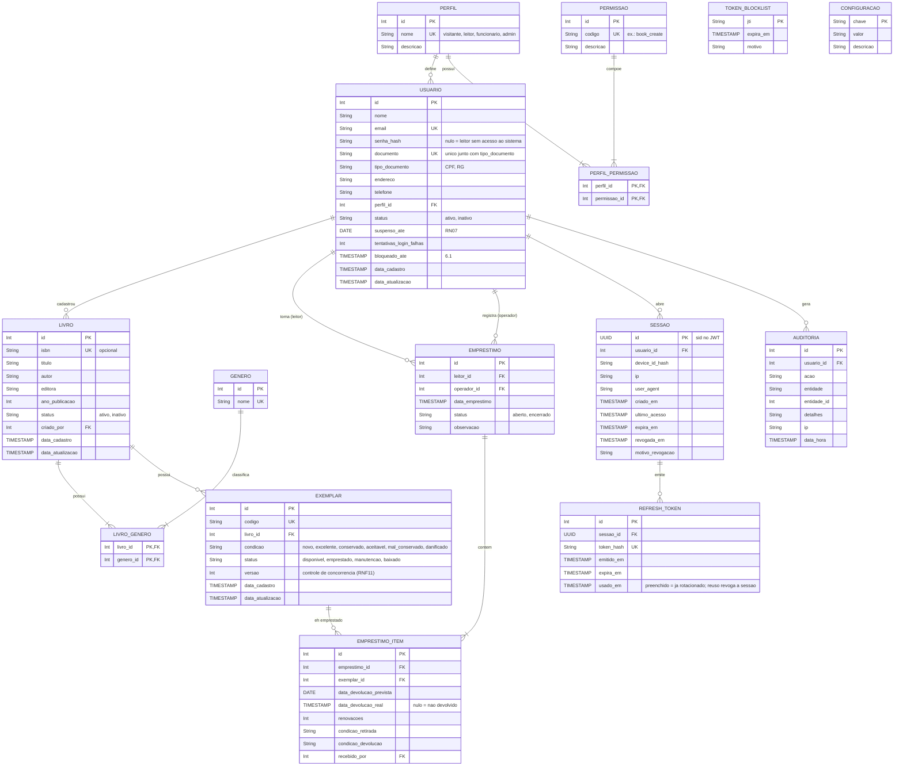

# Trabalho final da disciplina de Linguagem de Programação

Sistema de gerenciamento de **biblioteca comunitária**.

## 1. Descrição geral

O sistema gerencia uma biblioteca comunitária: organização do acervo, controle de exemplares, empréstimos, devoluções e acompanhamento de prazos.

Público do sistema:

- **Visitante** (sem login): consulta o catálogo público e a disponibilidade dos livros.
- **Leitor** (login opcional): acompanha os próprios empréstimos, prazos e histórico; pode solicitar renovação.
- **Funcionário**: cadastra livros, exemplares e leitores; registra empréstimos, devoluções e renovações; consulta relatórios.
- **Administrador**: tudo o que o funcionário faz, mais gestão de usuários do sistema, perfis/permissões, configurações e auditoria.

Escopo: **uma única biblioteca**. As regras de negócio foram definidas pela equipe (liberado pelo professor).

## 2. Conceitos aplicados

- Programação Orientada a Objetos
- Persistência de dados
- Interface de usuário
- Regras de negócio
- Geração de relatórios
- Segurança (autenticação, autorização e gestão de sessão)

## 3. Requisitos funcionais (RF)

### Acervo

- **RF01 – Cadastro de livros:** cadastrar, editar, consultar e inativar livros com: título, autor, gênero(s), editora, ano de publicação e ISBN (opcional, único quando informado).
- **RF02 – Cadastro de gêneros:** cadastrar e listar gêneros literários. Um livro pode ter **um ou mais gêneros**.
- **RF03 – Cadastro de exemplares:** cada livro possui N exemplares físicos, cada um com **código único**, condição de conservação e status. A quantidade de exemplares disponíveis de um livro é **calculada** a partir dos exemplares (não é digitada).
- **RF04 – Consulta ao acervo:** pesquisar por título, autor, gênero e ISBN, com filtros:
  - livros com exemplares disponíveis;
  - livros sem exemplares disponíveis;
  - livros/exemplares emprestados.
- **RF05 – Catálogo público:** visitantes (sem login) podem pesquisar livros e ver a quantidade disponível, sem acesso a dados de leitores.

### Leitores

- **RF06 – Cadastro de leitores:** cadastrar, editar, consultar e inativar leitores com: nome, documento (CPF ou RG), e-mail, telefone e endereço.
- **RF07 – Histórico do leitor:** exibir todos os empréstimos (ativos, atrasados e devolvidos) de um leitor.
- **RF08 – Acesso do leitor:** o funcionário pode habilitar login para o leitor; o leitor logado vê apenas os próprios empréstimos e prazos.

### Circulação

- **RF09 – Registro de empréstimo:** registrar um empréstimo com:
  - leitor;
  - um ou mais exemplares;
  - data do empréstimo (automática);
  - prazo previsto de devolução (padrão configurável, podendo ser ajustado até o máximo permitido);
  - funcionário que registrou (automático).
- **RF10 – Devolução:** registrar a devolução de um ou mais exemplares de um empréstimo, informando a condição do exemplar na devolução. A disponibilidade é atualizada automaticamente.
- **RF11 – Renovação:** renovar o prazo de um item emprestado, respeitando as regras de renovação. Pode ser feita pelo funcionário ou pelo próprio leitor.
- **RF12 – Empréstimos em aberto:** listar empréstimos ativos e atrasados, com filtro por leitor, livro e período.

### Relatórios

- **RF13 – Relatórios de circulação:**
  - número de empréstimos ativos;
  - número de empréstimos atrasados;
  - quantidade de empréstimos realizados por mês (filtro por período);
  - livros mais emprestados (top N);
  - leitores com empréstimos em atraso.
- **RF14 – Exportação:** exportar os relatórios em CSV.

### Segurança e administração

- **RF15 – Login:** autenticação por e-mail e senha.
- **RF16 – Logout:** encerra a sessão e revoga os tokens.
- **RF17 – Gestão de usuários do sistema:** o administrador cadastra funcionários e atribui perfis.
- **RF18 – Perfis e permissões:** cada funcionalidade exige uma permissão; permissões são agrupadas em perfis (ver seção 7).
- **RF19 – Configurações:** o administrador ajusta parâmetros de negócio (prazos, limites etc.) sem alterar código.
- **RF20 – Gestão de sessões:** o usuário vê suas sessões ativas e pode encerrá-las; o administrador pode encerrar sessões de qualquer usuário.
- **RF21 – Auditoria:** ações relevantes (login, falha de login, sessão revogada, criação/edição/exclusão, empréstimo, devolução) ficam registradas com usuário, data e IP.

## 4. Regras de negócio (RN)

Os valores entre parênteses são o **padrão**, todos parametrizáveis na tabela `CONFIGURACAO`.

### Empréstimo

- **RN01:** um leitor pode ter no máximo (**3**) exemplares emprestados ao mesmo tempo.
- **RN02:** prazo padrão de devolução de (**14**) dias; o funcionário pode definir outro prazo até o máximo de (**30**) dias.
- **RN03:** só podem ser emprestados exemplares com status `disponivel`. Exemplares em `manutencao`, `emprestado` ou `baixado` não podem ser emprestados.
- **RN04:** um leitor não pode ter dois exemplares do **mesmo livro** ao mesmo tempo.
- **RN05:** leitor **inativo**, **suspenso** ou com **qualquer item em atraso** não pode realizar novo empréstimo nem renovação.

### Devolução e atraso

- **RN06:** um item está **atrasado** quando não foi devolvido e a data prevista já passou. O atraso é **calculado na consulta**, não gravado no banco.
- **RN07:** ao devolver com atraso, o leitor fica **suspenso** por (**1**) dia para cada dia de atraso, contando o dia da devolução como o primeiro. Se vários itens forem devolvidos juntos, vale o **maior** atraso entre eles (não a soma). Uma suspensão nunca encurta outra que já esteja em andamento. Não há multa em dinheiro.
- **RN08:** na devolução é registrada a condição do exemplar. Se a condição for `danificado`, o exemplar vai para `manutencao`; caso contrário, volta para `disponivel`.
- **RN09:** cada item de um empréstimo pode ser devolvido separadamente; o empréstimo é `encerrado` quando todos os itens forem devolvidos.

### Renovação

- **RN10:** cada item pode ser renovado no máximo (**2**) vezes. A nova data é a data da renovação + o prazo padrão, mas **nunca antes da data prevista atual** (renovar cedo não encurta o prazo).
- **RN11:** não é possível renovar um item já atrasado.

### Cadastros

- **RN12:** exclusão é sempre **lógica** (soft delete), preservando o histórico.
- **RN13:** não é possível inativar livro, exemplar ou leitor que tenha empréstimo ativo.
- **RN14:** documento (CPF/RG) e e-mail de usuário são únicos; CPF deve ser validado (dígitos verificadores).
- **RN15:** código do exemplar é único e gerado automaticamente (ex.: `LIV000123-EX02`), podendo ser editado.
- **RN16:** exemplar `baixado` (extraviado ou descartado) não volta a circular.

## 5. Requisitos não funcionais (RNF)

- **RNF01 – Linguagem do backend:** Kotlin.
- **RNF02 – API:** REST, JSON, versionada em `/api/v1`, documentada pela coleção do Postman em `docs/postman/` (contrato com o frontend).
- **RNF03 – Senhas:** armazenadas como **hash BCrypt**, nunca em texto puro nem criptografadas de forma reversível.
- **RNF04 – Paginação:** listagens paginadas (`page`, `size`) com ordenação (`sort`).
- **RNF05 – Padrão de erros:** respostas de erro em formato único (ver seção 10.2).
- **RNF06 – Validação:** entradas validadas no backend, com mensagens claras por campo.
- **RNF07 – Testes:** testes de componente: a aplicação sobe inteira e cada regra é testada pela API (entrada HTTP → saída HTTP), incluindo segurança e permissões. Não há testes unitários isolados. O CI roda a suíte em H2 e em PostgreSQL a cada PR.
- **RNF08 – Execução local:** o projeto inteiro sobe com um único comando (`./run.sh`).
- **RNF09 – Datas:** instantes armazenados em UTC; o "hoje" das regras de prazo, atraso e suspensão é o do fuso `America/Fortaleza`.
- **RNF10 – Banco de dados:** H2 em desenvolvimento e testes; PostgreSQL em produção. O schema é criado só por migrations (Flyway) escritas em SQL compatível com os dois.
- **RNF11 – Concorrência:** dois atendimentos simultâneos do mesmo exemplar não geram dois empréstimos (controle otimista por versão; o segundo recebe 409).

## 6. Segurança: autenticação e sessão

### 6.1 Senhas e login

- Hash com **BCrypt** (inclui salt).
- Após (**5**) tentativas de login erradas seguidas, a conta fica bloqueada por (**15**) minutos (resposta `423 ACCOUNT_LOCKED`).
- Mensagem de erro genérica ("e-mail ou senha inválidos"), sem revelar se o e-mail existe.
- O administrador inicial (`admin@biblioteca.local`) recebe a senha da variável `ADMIN_SENHA_INICIAL` na primeira execução; depois, ela é trocada em `PUT /auth/password`.

### 6.2 Tokens

| Token | Duração | Onde fica | Conteúdo |
|---|---|---|---|
| Access token (JWT) | (**15 min**) | memória do frontend, enviado no header `Authorization: Bearer` | `sub` (usuário), `sid` (sessão), `jti` (id do token), `perfil`, `exp` |
| Refresh token | (**7 dias**) | cookie `HttpOnly`, `Secure` (em produção), `SameSite=Strict`, path `/api/v1/auth` | valor aleatório opaco; no banco fica só o hash |
| `device_id` | 1 ano | cookie `HttpOnly`, `SameSite=Strict`, path `/api` | identifica o navegador (ver 6.5); no banco fica só o hash |

### 6.3 Renovação (rotação de refresh token)

1. O frontend chama `POST /auth/refresh` quando o access token expira.
2. O backend valida o refresh token, **marca-o como usado** e emite um **novo par** (access + refresh).
3. **Detecção de reuso:** se um refresh token já usado for apresentado de novo, significa que ele foi copiado. A **sessão inteira é revogada** e o usuário precisa fazer login novamente.

### 6.4 Blocklist

- A blocklist guarda o `jti` de access tokens **revogados que ainda não expiraram** (logout, troca de senha, sessão suspeita). Tokens expirados já são recusados pela validação normal, então não precisam entrar na blocklist.
- Cada registro tem `expira_em` igual ao `exp` do token; uma rotina remove periodicamente os registros vencidos.

### 6.5 Uso do token em outro lugar

Requisito original: se o token de quem está em Quixadá aparecer sendo usado em outro lugar (ex.: na Rússia), o acesso deve ser barrado.

- No login, a sessão é **presa ao navegador**: o cookie `device_id` (HttpOnly, invisível ao JavaScript) e o User-Agent.
- Em toda requisição, o token só é aceito junto com o mesmo `device_id` e o mesmo User-Agent do login. Um JWT copiado para outra máquina chega sem esse cookie: a **sessão é encerrada na hora** (para o atacante e para o dono, que faz login de novo) e o evento vai para a auditoria.
- Mudança só de IP (ex.: Wi-Fi para 4G) é permitida e registrada na auditoria (`IP_ALTERADO`).
- Não há geolocalização por IP nem cálculo de "viagem impossível": a vinculação ao dispositivo já barra o cenário acima de forma mais simples.

## 7. Perfis e permissões

Cada funcionalidade exige uma permissão (`recurso_acao`). As permissões são associadas a perfis, e cada usuário possui um perfil.

| Permissão | Descrição | Visitante | Leitor | Funcionário | Admin |
|---|---|:-:|:-:|:-:|:-:|
| `book_read` | consultar livros e disponibilidade | ✔ | ✔ | ✔ | ✔ |
| `book_create` | cadastrar livro | | | ✔ | ✔ |
| `book_update` | editar livro | | | ✔ | ✔ |
| `book_delete` | inativar livro | | | ✔ | ✔ |
| `genre_manage` | cadastrar/editar gêneros | | | ✔ | ✔ |
| `copy_read` | consultar exemplares | | | ✔ | ✔ |
| `copy_manage` | cadastrar/editar/baixar exemplares | | | ✔ | ✔ |
| `reader_read` | consultar leitores | | | ✔ | ✔ |
| `reader_create` | cadastrar leitor | | | ✔ | ✔ |
| `reader_update` | editar leitor / habilitar login | | | ✔ | ✔ |
| `reader_delete` | inativar leitor | | | ✔ | ✔ |
| `loan_create` | registrar empréstimo | | | ✔ | ✔ |
| `loan_read` | consultar todos os empréstimos | | | ✔ | ✔ |
| `loan_read_own` | consultar os próprios empréstimos | | ✔ | | |
| `loan_return` | registrar devolução | | | ✔ | ✔ |
| `loan_renew` | renovar qualquer empréstimo | | | ✔ | ✔ |
| `loan_renew_own` | renovar o próprio empréstimo | | ✔ | | |
| `report_read` | relatórios e exportação | | | ✔ | ✔ |
| `session_manage_own` | ver/encerrar as próprias sessões | | ✔ | ✔ | ✔ |
| `session_manage` | encerrar sessões de qualquer usuário | | | | ✔ |
| `user_manage` | gerenciar funcionários/administradores | | | | ✔ |
| `role_manage` | gerenciar perfis e permissões | | | | ✔ |
| `config_manage` | alterar configurações de negócio | | | | ✔ |
| `audit_read` | consultar auditoria | | | | ✔ |

## 8. Modelagem de dados



### 8.1 Campos calculados (não armazenados)

- **Exemplares disponíveis de um livro:** `COUNT(exemplar WHERE livro_id = X AND status = 'disponivel')`.
- **Situação de um item de empréstimo:**
  - `devolvido`: `data_devolucao_real` preenchida;
  - `atrasado`: não devolvido e `data_devolucao_prevista < hoje`;
  - `ativo`: não devolvido e dentro do prazo.

### 8.2 Configurações iniciais (`CONFIGURACAO`)

| Chave | Valor padrão |
|---|---|
| `emprestimo.max_itens_por_leitor` | 3 |
| `emprestimo.prazo_padrao_dias` | 14 |
| `emprestimo.prazo_maximo_dias` | 30 |
| `emprestimo.max_renovacoes` | 2 |
| `suspensao.dias_por_dia_atraso` | 1 |
| `login.max_tentativas` | 5 |
| `login.bloqueio_minutos` | 15 |
| `jwt.access_minutos` | 15 |
| `jwt.refresh_dias` | 7 |

Todas podem ser alteradas em `PUT /settings/{chave}` (permissão `config_manage`) e valem na hora.

## 9. Organização do repositório

```
biblioteca/
├── .github/workflows/      # CI: md-policy e backend (testes em H2 e PostgreSQL)
├── .githooks/              # hooks locais (pre-commit)
├── backend_biblioteca/     # API em Kotlin
├── frontend_biblioteca/    # interface web
├── docs/
│   ├── objetivo.md         # este documento (requisitos e decisões)
│   ├── backend.md          # arquitetura, convenções e como rodar o backend
│   ├── pull_request_template.md
│   └── postman/            # coleções e ambientes do Postman
├── README.md
└── run.sh                  # sobe banco, backend e frontend localmente
```

Repositório: `git@github.com:Framks/biblioteca.git` (monorepo com backend e frontend). Regras de colaboração no `README.md`.

## 10. Contrato da API

Base: `/api/v1`. Corpo, respostas, exemplos e códigos de erro de cada endpoint estão na coleção do Postman (`docs/postman/biblioteca.postman_collection.json`).

### 10.1 Endpoints

| Método | Rota | Permissão | Descrição |
|---|---|---|---|
| POST | `/auth/login` | pública | login; retorna access token e seta cookies |
| POST | `/auth/refresh` | cookie refresh | rotaciona tokens |
| POST | `/auth/logout` | autenticado | revoga sessão atual |
| GET | `/auth/me` | autenticado | dados e permissões do usuário logado |
| PUT | `/auth/password` | autenticado | troca a própria senha (encerra as outras sessões) |
| GET | `/auth/sessions` | `session_manage_own` | sessões ativas do usuário |
| DELETE | `/auth/sessions/{id}` | `session_manage_own` / `session_manage` | encerra uma sessão própria / de qualquer usuário |
| GET | `/catalog/books` | pública | catálogo público com disponibilidade |
| GET | `/books` | `book_read` | lista/pesquisa livros (filtros RF04) |
| GET | `/books/{id}` | `book_read` | detalhe do livro, com as quantidades de exemplares |
| POST | `/books` | `book_create` | cadastra livro |
| PUT | `/books/{id}` | `book_update` | edita livro |
| DELETE | `/books/{id}` | `book_delete` | inativa livro |
| GET | `/genres` | pública | lista gêneros (usado também pelo catálogo) |
| POST | `/genres` | `genre_manage` | cadastra gênero |
| PUT | `/genres/{id}` | `genre_manage` | renomeia gênero |
| GET | `/books/{id}/copies` | `copy_read` | exemplares do livro |
| POST | `/books/{id}/copies` | `copy_manage` | adiciona exemplar(es) |
| GET | `/copies/{id}` | `copy_read` | detalhe do exemplar |
| PATCH | `/copies/{id}` | `copy_manage` | altera código, condição ou status (manutenção, baixa) |
| GET | `/readers` | `reader_read` | lista/pesquisa leitores |
| GET | `/readers/{id}` | `reader_read` | detalhe do leitor |
| POST | `/readers` | `reader_create` | cadastra leitor |
| PUT | `/readers/{id}` | `reader_update` | edita leitor |
| POST | `/readers/{id}/access` | `reader_update` | habilita login do leitor |
| DELETE | `/readers/{id}` | `reader_delete` | inativa leitor |
| GET | `/readers/{id}/loans` | `loan_read` | histórico do leitor |
| GET | `/loans` | `loan_read` | lista empréstimos (filtro: ativo, atrasado, devolvido) |
| GET | `/loans/me` | `loan_read_own` | empréstimos do leitor logado |
| POST | `/loans` | `loan_create` | registra empréstimo |
| GET | `/loans/{id}` | `loan_read` | detalhe do empréstimo |
| POST | `/loans/{id}/return` | `loan_return` | devolve um ou mais itens |
| POST | `/loans/items/{itemId}/renew` | `loan_renew` / `loan_renew_own` | renova item |
| GET | `/reports/summary` | `report_read` | ativos, atrasados, total |
| GET | `/reports/loans-per-month` | `report_read` | empréstimos por mês |
| GET | `/reports/top-books` | `report_read` | livros mais emprestados |
| GET | `/reports/overdue-readers` | `report_read` | leitores em atraso |
| GET | `/reports/{relatório}/export` | `report_read` | exportação CSV de qualquer um dos quatro relatórios acima |
| GET/POST | `/users` | `user_manage` | lista / cadastra funcionários e administradores |
| GET/PUT/DELETE | `/users/{id}` | `user_manage` | detalhe / edita / inativa |
| PUT | `/users/{id}/password` | `user_manage` | redefine a senha (encerra as sessões do usuário) |
| GET | `/users/{id}/sessions` | `session_manage` | sessões ativas de um usuário |
| GET | `/roles` | `role_manage` | perfis com suas permissões |
| GET | `/permissions` | `role_manage` | as 24 permissões |
| PUT | `/roles/{id}/permissions` | `role_manage` | define as permissões de um perfil (ADMIN e VISITANTE não são editáveis) |
| GET | `/settings` | autenticado | configurações de negócio |
| PUT | `/settings/{chave}` | `config_manage` | altera uma configuração |
| GET | `/audit` | `audit_read` | auditoria |

### 10.2 Formato de erro

```json
{
  "status": 422,
  "code": "LOAN_LIMIT_EXCEEDED",
  "message": "O leitor já possui 3 exemplares emprestados.",
  "fields": [
    { "field": "exemplarIds", "message": "limite excedido" }
  ],
  "timestamp": "2026-11-09T20:00:00Z",
  "path": "/api/v1/loans"
}
```

Códigos HTTP: `400` entrada inválida, `401` não autenticado/token inválido, `403` sem permissão, `404` não encontrado, `409` conflito (ex.: duplicidade, `CONCURRENT_UPDATE`), `422` regra de negócio violada, `423` login bloqueado. O `code` é estável e pode ser usado pelo frontend; a `message` é para o usuário.

### 10.3 Formato de listagem paginada

```json
{
  "content": [],
  "page": 0,
  "size": 20,
  "totalElements": 0,
  "totalPages": 0
}
```

## 11. Fluxo de trabalho

- **Backend**
  - [x] Melhorar requisitos do `objetivo.md`
  - [x] Definir linguagem: **Kotlin**
  - [x] Definir framework: **Spring Boot 4**
  - [x] Definir arquitetura: camadas com facade (ver `docs/backend.md`)
  - [x] Definir padrões de projeto
  - [x] Definir banco de dados: H2 (dev/testes) e PostgreSQL (produção)
  - [x] Definir estrutura dos testes: testes de componente pela API
  - [x] Criar coleção do Postman (contrato para o frontend)
  - [x] Implementar todos os RF, RN e a seção 6
- **Frontend**
  - [ ] Definir tecnologia
  - [ ] Implementar telas a partir da coleção do Postman
- **Integração**
  - [x] Criar `run.sh` para rodar todo o projeto na máquina local
  - [x] CI: testes do backend em H2 e PostgreSQL obrigatórios para o merge

## 12. Decisões já tomadas

- O professor liberou a equipe para definir as regras de negócio e a forma de construir o sistema.
- Sistema para **uma única biblioteca**.
- **Livro ≠ exemplar:** cada exemplar tem identificação única, estado de conservação e rastreabilidade de quem o pegou.
- Um livro pode ter **vários gêneros**.
- Limites, prazos e renovações são **parametrizáveis** (seção 8.2).
- Há uma **área pública** de consulta ao acervo para visitantes.
- **Divisão do time:** backend em Kotlin; frontend com outro membro do time.
- **Backend:** Kotlin + Spring Boot 4, JPA/Hibernate, Flyway, Spring Security com JWT (Nimbus). Arquitetura em camadas Controller → Facade → Service → Repository (detalhes e convenções em `docs/backend.md`).
- **Documentação da API:** coleção do Postman em `docs/postman/` (sem OpenAPI).
- **Testes:** só testes de componente, pela API; rodam em H2 e em PostgreSQL no CI.
- **Leitor e funcionário na mesma tabela** (`usuario`), diferenciados pelo perfil. Leitor sem senha não faz login.
- **Visitante não tem conta:** é o acesso anônimo às rotas públicas (`/catalog/**`, `GET /genres`).
- **Seção 6.5 simplificada:** vinculação da sessão ao dispositivo/navegador, sem geolocalização.
